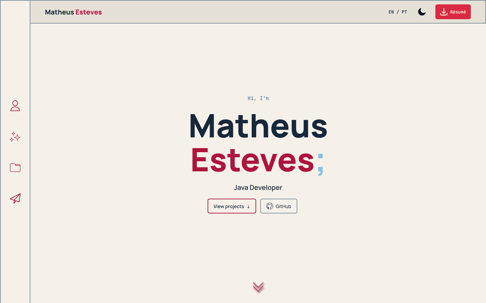
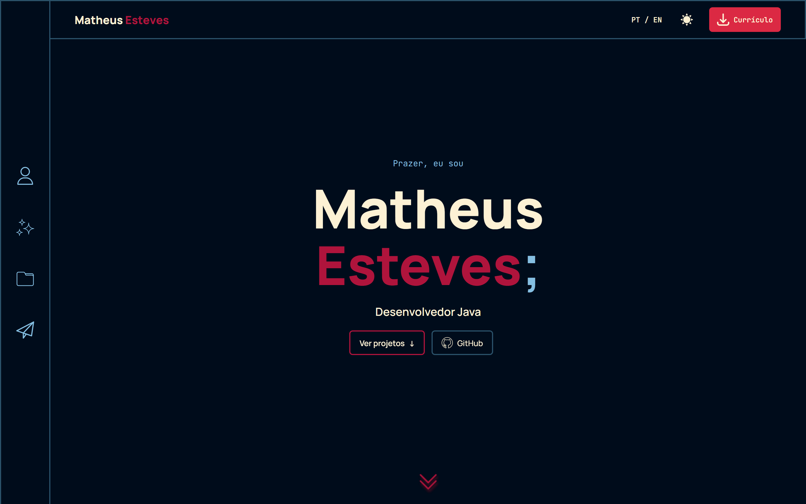
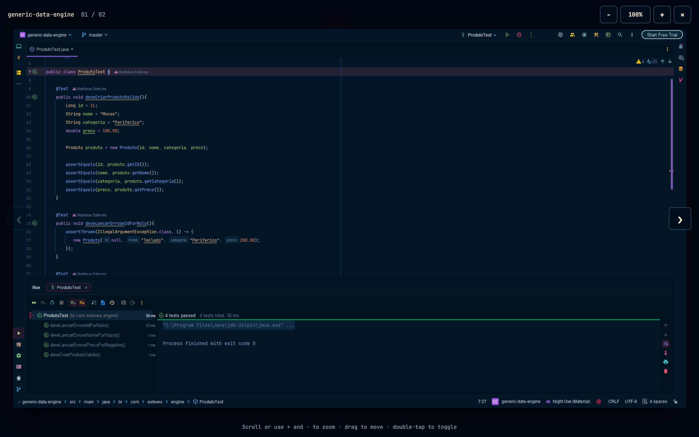
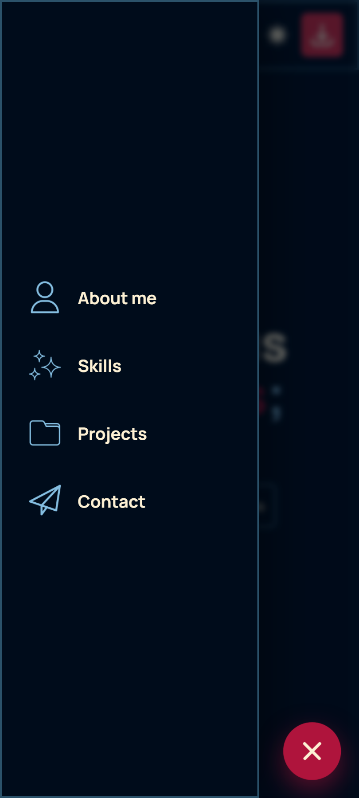
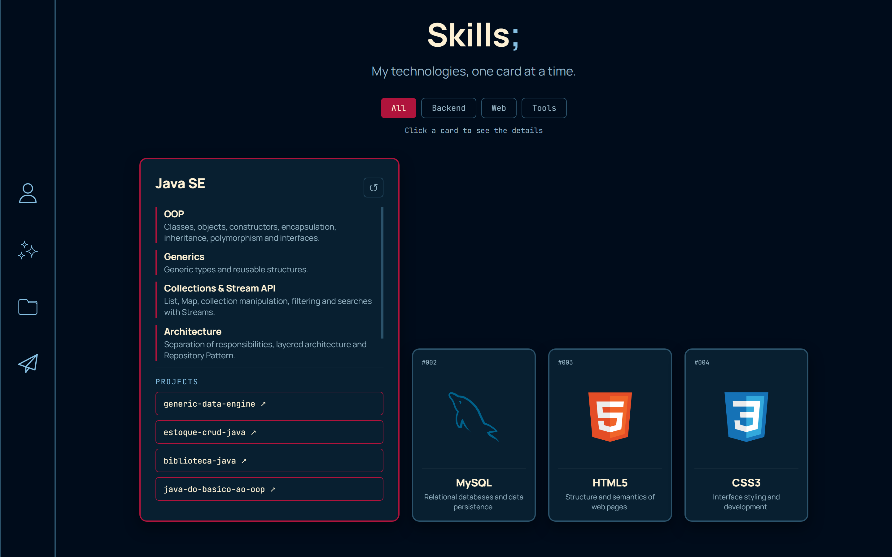

# Matheus Esteves | Portfólio

Este é meu portfólio pessoal, desenvolvido para apresentar minha trajetória na programação, minhas habilidades técnicas e os projetos que venho construindo durante meus estudos.
A aplicação foi criada com **HTML, CSS e JavaScript**, sem frameworks de interface. O foco está em combinar uma apresentação visual própria com recursos interativos e navegação adaptada a diferentes tamanhos de tela.


<p align="center">
  <a href="https://esteves-mth.github.io/portfolio-esteves/">Acessar portfólio</a>
  ·
  <a href="https://github.com/esteves-mth">GitHub</a>
</p>

---

## Prévia

### Página inicial — modo claro



### Página inicial — modo escuro



### Visualizador de imagens — zoom



### Menu mobile

<p align="center">
  
</p>

### Card de habilidade aberto



---

## Funcionalidades

- **Tema claro e escuro:** alternância entre os temas, com preferência salva no navegador.
- **Português e inglês:** alternância de idioma.
- **Introdução interativa:** apresentação com animação em estilo terminal.
- **Menu mobile:** navegação lateral adaptada a dispositivos móveis.
- **Habilidades interativas:** cards expansíveis com informações sobre conhecimentos e tecnologias.
- **Filtros de projetos:** organização dos projetos por tecnologia.
- **Carrossel de projetos:** navegação entre os projetos.
- **Visualizador de imagens:** ampliação, zoom, movimentação e navegação entre imagens.
- **Navegação relacionada:** acesso às habilidades a partir das tecnologias associadas aos projetos.

## Tecnologias utilizadas

- HTML5
- CSS3
- JavaScript

## Executar localmente

1. Clone o repositório:

   ```bash
   git clone https://github.com/esteves-mth/portfolio-esteves.git
   ```

2. Entre na pasta:

   ```bash
   cd portfolio-esteves
   ```

3. Abra o arquivo `index.html` no navegador.

Também é possível utilizar a extensão Live Server no Visual Studio Code.

## Estrutura principal

```text
portfolio-esteves/
├── index.html   # Estrutura e conteúdo da página
├── style.css    # Estilos, temas, responsividade e animações
├── script.js    # Dados e funcionalidades interativas
└── img/         # Imagens, screenshots e recursos visuais
```


## Acesso

A versão publicada está disponível em:

**https://esteves-mth.github.io/portfolio-esteves/**

## Autor

**Matheus Esteves**

- GitHub: [@esteves-mth](https://github.com/esteves-mth)
- LinkedIn: [Matheus Esteves](https://www.linkedin.com/in/matheus-esteves-05270835b/)
